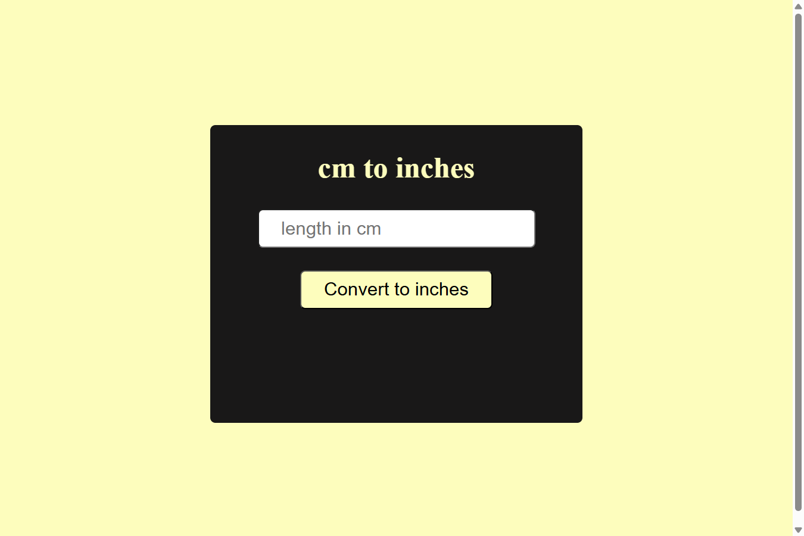

# CM to Inches Converter

A small, easy-to-use web app for converting a measurement from centimeters (cm) to inches (in). Enter a value in centimeters and select **Convert to inches** to see the converted measurement.

## Website Preview



## Live Demo

https://your-site-name.netlify.app

Replace this placeholder with the live URL for your site.

## Features

- Converts a centimeter measurement into inches
- Rounds the displayed result to two decimal places
- Works in a web browser without installing anything

## Conversion Formula

One inch equals 2.54 centimeters. The app converts centimeters to inches by dividing the entered value by 2.54:

```text
inches = centimeters / 2.54
```

For example, entering `10` centimeters gives `3.94 inches` after rounding to two decimal places.

## How to Use

1. Open the app in your browser.
2. Enter a length in centimeters in the input field.
3. Select **Convert to inches**.
4. Read the result shown below the button.

## Project Files

- `index.html` contains the converter's page structure and conversion behavior.
- `style.css` contains the page's visual styles.
- `script.js` is included in the project; the current converter logic is in `index.html`.

## Run Locally

Open `index.html` in a web browser. No installation or build step is required.